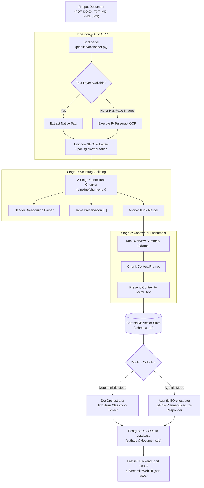
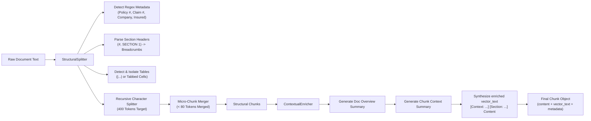
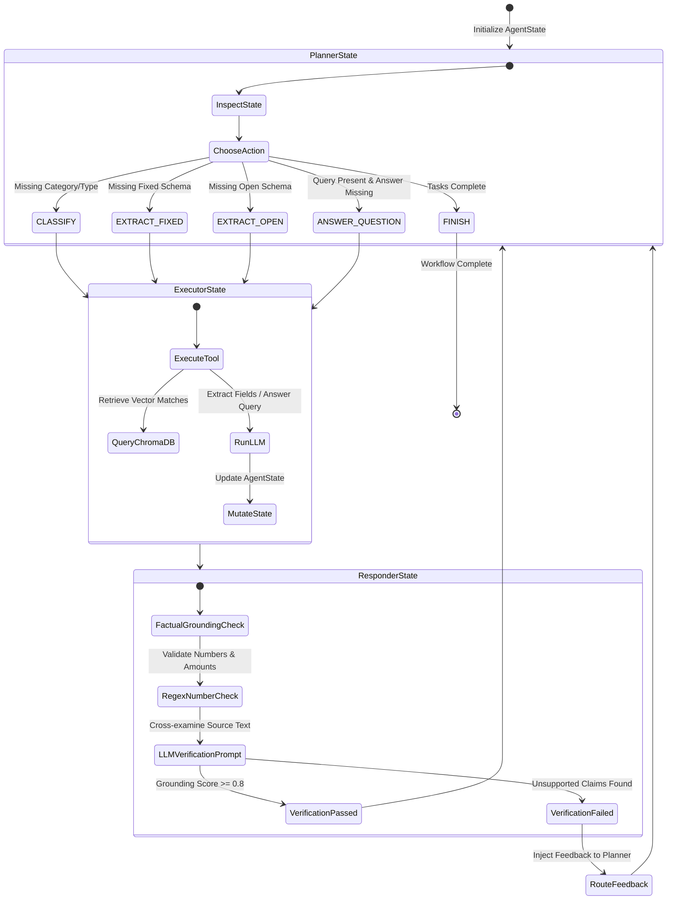
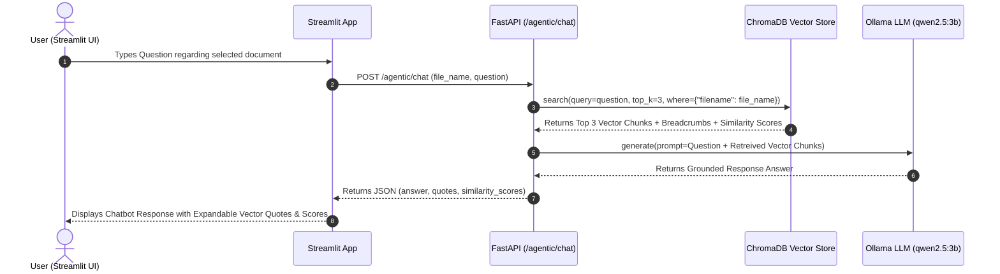

# 📚 Complete Technical Specification & Comprehensive Project Documentation

---

## 1. System Overview & Architectural Philosophy

The **Smart Insurance Document Router & AgenticIE System** is a privacy-first, 100% offline Intelligent Document Processing (IDP), RAG Chunking, and Agentic Information Extraction engine for complex insurance documents.

### Key Architectural Principles:
1. **100% Privacy & Offline Execution**: All LLM processing (Ollama `qwen2.5:3b`), vector embeddings (`nomic-embed-text`), and OCR (PyTesseract) execute strictly locally on the target host machine. No document data or tokens leave the local system.
2. **Dual-Pipeline Design**:
   - **Deterministic Pipeline (`DocOrchestrator`)**: Fast, lightweight two-turn (Classify -> Extract) process suitable for high-throughput batch classification.
   - **Agentic Pipeline (`AgenticIEOrchestrator`)**: 3-role Planner-Executor-Responder agent loop for complex, unstructured, or open-schema extraction, RAG search, and verified Q&A.
3. **Deterministic Automatic OCR**: Automatic OCR is built into the document loading layer (`pipeline/docloader.py`). Native text is extracted first; any embedded scanned images inside PDFs or standalone image files are automatically OCR'd at load time.
4. **2-Stage Contextual Retrieval & Structural Chunker**: Combines structural block parsing (header breadcrumbs and table preservation) with Anthropic-style contextual enrichment to maximize vector retrieval accuracy.
5. **Zero Hallucination Guarantee**: The Responder agent verifies all numbers, dates, policy IDs, and claim amounts against raw source text before accepting an extraction.

---

## 2. System Architecture & Flow Diagrams

### 2.1 End-to-End System Processing Flow


---

### 2.2 2-Stage Contextual Chunking Flow


---

### 2.3 3-Role AgenticIE State Loop Flow


---

### 2.4 Interactive RAG Document Chatbot Flow


---

## 3. Real-World Insurance Use Cases & Scenarios

### Use Case 1: Health Insurance Hospitalization & Cashless Pre-Authorization Claim
* **Scenario**: A policyholder is admitted to a network hospital for an emergency procedure. The hospital sends a 6-page hybrid document containing a typed Pre-Authorization Request, a scanned doctor prescription, and an itemized medical billing breakdown table.
* **System Execution**:
  1. **Ingestion & Auto OCR**: `PdfFileLoader` extracts the native text from pages 1-4 and automatically runs Tesseract OCR on the scanned prescription image on page 5.
  2. **Chunking & RAG**: `StructuralSplitter` identifies the itemized room rent and surgery cost table, keeping it intact. `ContextualEnricher` prepends section breadcrumbs (`["Pre-Authorization", "Estimated Expenses"]`).
  3. **AgenticIE Extraction**:
     - *Planner*: Selects `CLASSIFY_DOCUMENT` -> Category: `MEDICAL_INSURANCE`, Type: `HOSPITAL_CASHLESS_REQUEST`.
     - *Executor*: Populates `MedicalReportFields` (`patient_name: "John Doe"`, `diagnosis: "Acute Appendicitis"`, `hospital_name: "City General"`, `report_date: "2025-03-15"`).
     - *Open Schema*: Discovers itemized tables: Room Rent ($1,200), ICU Charges ($3,500), Surgeon Fee ($4,000).
     - *Responder*: Cross-verifies $8,700 total estimate against raw invoice text. Grounding score = 0.98. Passed.

---

### Use Case 2: Motor Vehicle Accident Damage & Surveyor Loss Assessment
* **Scenario**: Following a motor accident, an independent loss surveyor submits a damage assessment report containing photo estimates, vehicle RC details, and an itemized garage repair estimate.
* **System Execution**:
  1. **Ingestion**: `DocxFileLoader` processes the surveyor report `.docx` file.
  2. **Chunking**: Preserves the multi-column parts & labor cost table.
  3. **AgenticIE Processing**:
     - *Classification*: Category: `MOTOR_INSURANCE`, Type: `SURVEYOR_REPORT`.
     - *Fixed Extraction*: Populates `SurveyReportFields` (`survey_number: "SURV-8821"`, `surveyor_name: "Robert Smith"`, `assessed_loss_amount: 3450.00`).
     - *Open Schema*: Discovers parts breakdown: Front Bumper Replacement ($650), Headlight Assembly ($450), Frame Realignment Labor ($1,200).
     - *Interactive Chatbot*: Claims handler asks *"What was the surveyor's conclusion regarding third-party liability?"* Chatbot retrieves vector chunk from section `"Surveyor Observations"` and answers directly.

---

### Use Case 3: Commercial Property Fire Incident & Inventory Assessment
* **Scenario**: A factory suffers fire damage. The insured submits a 25-page PDF containing policy details, fire department incident reports, and a 100-row inventory loss spreadsheet.
* **System Execution**:
  1. **Chunking**: `ContextualChunker` splits the 25-page document into 18 structured chunks while preserving 4 large inventory tables across chunks.
  2. **ChromaDB Indexing**: Vector embeddings are indexed into `./chroma_db` with metadata filters (`company: "Acme Industrial"`, `policy_number: "PROP-9912"`).
  3. **RAG QA**: Adjuster types *"What was the assessed total loss for raw material stock in Building B?"* ChromaDB retrieves Chunk #12 (similarity score 0.92), and the model answers: *"Raw material stock loss in Building B was assessed at $142,500."*

---

### Use Case 4: Life Insurance Death Claim & Nominee Settlement
* **Scenario**: A beneficiary submits a life insurance death claim consisting of a Death Certificate image, Nominee Designation Form, and Physician Statement.
* **System Execution**:
  1. **Auto OCR**: `ImageFileLoader` runs OCR on the scanned Death Certificate image.
  2. **Classification**: Category: `LIFE_INSURANCE`, Type: `DEATH_CLAIM_FORM`.
  3. **Verification**: Responder agent checks that the cause of death date on the Physician Statement matches the date on the Death Certificate. Grounding check verifies nominee name `"Mary Watson"`.

---

### Use Case 5: Automated Policy Tariff Billing & Renewal Audit
* **Scenario**: An insurance agency receives 500 policy renewal notices in batch.
* **System Execution**:
  1. **Deterministic Mode**: Uses FastAPI `POST /classify` (`DocOrchestrator`) for ultra-fast two-turn batch classification.
  2. **Extraction**: Extracts `policy_number`, `premium_amount`, `due_date`, `insured_name`.
  3. **Audit Log**: Every execution records input/output token metrics and inference time into `pipeline_events.jsonl` for compliance reporting.

---

## 4. Directory Layout & Module Structure

```text
Insurance Agent/
├── models/                    # Pydantic Data Transfer Objects & Schemas
│   ├── __init__.py
│   ├── docmodels.py           # Classification & Extraction schemas, Domain Metadata
│   ├── agentic_models.py       # AgentState, PlannerAction, ExecutionStep
│   ├── authmodels.py          # User registration & JWT Token DTOs
│   └── documents_models.py    # Document Summary & Detail API response DTOs
│
├── db/                        # Storage & Authentication Layer
│   ├── __init__.py
│   ├── authdb.py              # User table & SQLAlchemy Engine
│   ├── documentsdb.py         # Document & AgenticExecution tables
│   └── auth.py                # JWT creation, Bcrypt hashing, get_current_user
│
├── pipeline/                  # Ingestion, Chunking & RAG Vector Engine
│   ├── __init__.py
│   ├── docloader.py           # Multi-format Loaders & Automatic OCR
│   ├── chunker.py             # 2-Stage Contextual & Structural Chunker
│   ├── docclient.py           # Ollama REST API Client wrapper
│   ├── docparsers.py          # JSON parsers & Pydantic validators
│   ├── docorchestrator.py     # Deterministic two-turn orchestrator
│   └── vectorstore.py         # Persistent ChromaDB store & embeddings
│
├── agents/                    # 3-Role AgenticIE Architecture
│   ├── __init__.py
│   └── agentic_ie.py          # Planner, Executor, Responder agents
│
├── utils/                     # Event Loggers & UI Formatting Helpers
│   ├── __init__.py
│   ├── doc_pipeline_logger.py     # Pipeline event JSONL logger
│   ├── agentic_pipeline_logger.py # Agentic step JSONL logger
│   └── ui_helpers.py              # Streamlit UI display helpers
│
├── tests/                     # Test Suite (pytest)
│   ├── test_chunker.py
│   ├── test_vectorstore.py
│   ├── testorchestrator.py
│   ├── test_agentic_ie.py
│   └── testapp.py
│
├── app.py                     # FastAPI REST API Application
├── authrouter.py              # Authentication API Router (/register, /token)
├── streamlit_app.py           # Streamlit Web UI Frontend
├── requirements.txt           # Python package requirements
├── README.md                  # Project Overview
├── dockerfile                 # Docker Image specification
└── docker-compose.yml         # Docker Compose multi-service configuration
```

---

## 5. Exhaustive Module Specifications

### 5.1 Data Models & Schemas (`models/`)

#### `models/docmodels.py`
- **`DocumentCategory` (Enum)**: 15 categories (`POLICY_DOCUMENTS`, `CLAIMS`, `MEDICAL_INSURANCE`, `MOTOR_INSURANCE`, `LIFE_INSURANCE`, etc.).
- **`DocumentType` (Enum)**: 40+ specific insurance document types.
- **`CATEGORY_TYPE_MAP`**: Mapping dictionary connecting categories to allowable document types.
- **`ClassificationResult`**: Pydantic model with validator enforcing valid category-type pairs.
- **Extraction Models**: `PolicyFields`, `ClaimFields`, `SurveyReportFields`, `PremiumBillingFields`, `MedicalReportFields`, `GenericInsuranceFields`.
- **`PipelineResult`**: Pipeline output object with computed properties (`total_tokens`, `total_inference_time`).
- **Metadata Models**: `InsuranceDomainMetadata`, `DocumentFileMetadata`, `PipelineAuditMetadata`, `EnrichedDocumentPayload`.

#### `models/agentic_models.py`
- **`PlannerToolName`**: Enum for all agent tools.
- **`PlannerAction`**, **`ExecutionStep`**, **`OpenSchemaResult`**, **`VerificationResult`**, **`AgentState`**.

#### `models/authmodels.py`
- `UserCreate`, `UserOut`, `Token`, `TokenData`.

#### `models/documents_models.py`
- `DocumentSummary`, `DocumentDetail`.

---

### 5.2 Ingestion & RAG Pipeline (`pipeline/`)

#### `pipeline/docloader.py`
- Protocol `FileTypeLoader` implemented by `TextFileLoader`, `PdfFileLoader`, `DocxFileLoader`, and `ImageFileLoader`.
- `PdfFileLoader` extracts page text and automatically runs PyTesseract OCR on embedded `page.images`.
- `ImageFileLoader` runs PyTesseract OCR on images automatically.
- Text normalization (`_normalize_text`, `_collapse_letter_spacing`).

#### `pipeline/chunker.py`
- **`count_tokens`**: Uses `tiktoken` (`cl100k_base`) with estimation fallback.
- **`StructuralSplitter`**: Extracts document metadata, parses headers into breadcrumbs, preserves table blocks (`|...|`), and merges micro-chunks (< 80 tokens).
- **`ContextualEnricher`**: Generates overview summaries and prepends context to `vector_text`.
- **`ContextualChunker`**: Complete two-stage chunker.

#### `pipeline/vectorstore.py`
- `VectorStoreManager`: Persistent ChromaDB client at `./chroma_db`.
- `OllamaEmbeddingFunction`: Local embeddings via Ollama `/api/embeddings`. Includes fallback hash cosine search.

#### `pipeline/docclient.py` & `docparsers.py`
- Ollama REST client wrapper and JSON code fence parser.

#### `pipeline/docorchestrator.py`
- Two-turn deterministic orchestrator.

---

### 5.3 3-Role AgenticIE System (`agents/agentic_ie.py`)

- **`Planner`**: Selects tool action based on state.
- **`Executor`**: Runs tool actions and ChromaDB search.
- **`Responder`**: Factual grounding check against source text with feedback rerouting.

---

### 5.4 Storage & Auth Layer (`db/`)

- `authdb.py`: SQLAlchemy `User` model & SQLite database.
- `documentsdb.py`: SQLAlchemy `Document` and `AgenticExecution` tables.
- `auth.py`: Bcrypt hashing, JWT tokens (`python-jose`), and `get_current_user` dependency.

---

### 5.5 Logging & Utilities (`utils/`)

- Thread-safe JSONL loggers (`pipeline_events.jsonl`, `agentic_pipeline_events.jsonl`) and Streamlit UI display helpers.

---

## 6. REST API Endpoint Reference (`app.py` & `authrouter.py`)

| Endpoint | Method | Security | Request Body / Params | Response Model | Description |
| :--- | :--- | :--- | :--- | :--- | :--- |
| `/register` | `POST` | Public | `UserCreate` (`username`, `password`) | `UserOut` | Registers a new user account. |
| `/token` | `POST` | Public | Form (`username`, `password`) | `Token` | Validates credentials and returns JWT token. |
| `/health` | `GET` | Public | None | `dict` | Health check & Ollama reachability status. |
| `/classify` | `POST` | Bearer JWT | File upload (`multipart/form-data`) | `PipelineResult` | Runs deterministic two-turn pipeline. |
| `/agentic/process` | `POST` | Bearer JWT | File upload, optional `user_query` | `dict` (Agent State) | Runs 3-role AgenticIE pipeline. |
| `/agentic/chat` | `POST` | Bearer JWT | `file_name`, `question` | `dict` (`answer`, `quotes`) | Multi-turn RAG chatbot query on document. |
| `/agentic/executions` | `GET` | Bearer JWT | None | `list[dict]` | Returns user's past agentic executions. |
| `/documents` | `GET` | Bearer JWT | None | `list[DocumentSummary]` | Returns user's stored documents. |
| `/documents/{id}` | `GET` | Bearer JWT | `document_id` | `DocumentDetail` | Returns full detail for a single document. |

---

## 7. Streamlit Web UI & Interactive RAG Chatbot (`streamlit_app.py`)

- **Authentication Gate**: Requires user login/registration.
- **Tabs**:
  1. **📥 Classify (Deterministic)**: Fast batch processing.
  2. **🤖 AgenticIE Router & QA**: Multi-agent processing with open schema discovery.
  3. **💬 Document QA & Interactive Chatbot**: Multi-turn chatbot communicating with ChromaDB vector store.
  4. **🧩 Contextual Chunks**: Inspect breadcrumbs, table preservation, and test vector similarity search.
  5. **📁 My Documents**: View processed document details and extraction fields.

---

## 8. Docker Containerization Setup

### `dockerfile`
- Base: `python:3.11-slim`
- Packages: `tesseract-ocr`, `tesseract-ocr-eng`, `libgl1`, `libglib2.0-0`
- Exposes ports `8000` (FastAPI) and `8501` (Streamlit)

### `docker-compose.yml`
- Service `backend`: FastAPI API container running on port `8000` (`http://host.docker.internal:11434` for Ollama). Volume mounts for `auth.db`, `chroma_db`, `uploads`, and `logs`.
- Service `frontend`: Streamlit UI container running on port `8501`.

---

## 9. Comprehensive Dependencies & Libraries Reference

### 9.1 Web Framework & Networking
* **`fastapi` (>=0.115)**: Modern, asynchronous Python web framework used to expose high-performance REST endpoints (`/classify`, `/agentic/process`, `/agentic/chat`, `/documents`).
* **`uvicorn[standard]` (>=0.32)**: Asynchronous Server Gateway Interface (ASGI) production web server running the FastAPI application.
* **`python-multipart` (>=0.0.12)**: Form-data parser enabling `UploadFile` multi-part document file uploads.
* **`requests` (>=2.32)**: Synchronous HTTP client library used to communicate with local Ollama REST endpoints (`/api/generate`, `/api/embeddings`).

### 9.2 Frontend UI
* **`streamlit` (>=1.38.0)**: Interactive web app framework (`streamlit_app.py`) rendering the agent workflow step inspector, RAG chunk previewer, and multi-turn document chatbot UI.

### 9.3 LLM, RAG & Vector Search
* **`chromadb` (>=0.5.0)**: Persistent vector database library (`./chroma_db`) storing contextual vector chunks, embedding vectors, and metadata filters (`where_filter`).
* **`tiktoken` (>=0.7.0)**: Fast BPE token counter (`cl100k_base` encoding) used in `pipeline/chunker.py` for exact LLM context window budgeting.
* **`ollama` (Local System Service)**: Host-native LLM runner serving `qwen2.5:3b` for classification, extraction, and Q&A, plus `nomic-embed-text` for vector embeddings.

### 9.4 Ingestion & Automatic OCR
* **`pypdf` (>=5.0)**: Native PDF parser extracting document text layers and page image objects (`page.images`).
* **`python-docx` (>=1.1)**: Microsoft Word (`.docx`) file loader extracting paragraph text and table cell values.
* **`pytesseract` (>=0.3.10)**: Python wrapper for Google Tesseract OCR engine executing automatic optical character recognition on scanned PDF page images and standalone `.png`, `.jpg`, `.jpeg`, `.tiff`, `.bmp` files.
* **`pillow` (`PIL`) (>=10.0.0)**: Image manipulation library converting image bytes to PIL images for PyTesseract OCR.

### 9.5 Data Schemas & Validation
* **`pydantic` (>=2.9)**: Data validation and settings management library enforcing strict schemas for classification (`ClassificationResult`), field extraction (`PolicyFields`, `ClaimFields`, etc.), agent actions (`PlannerAction`), and audit metadata (`InsuranceDomainMetadata`, `PipelineAuditMetadata`).

### 9.6 Database & Authentication
* **`sqlalchemy` (>=2.0)**: Object-Relational Mapper (ORM) managing local SQLite databases (`auth.db`) for user accounts, document execution records, and agent states (`User`, `Document`, `AgenticExecution`).
* **`bcrypt` (>=4.0.1)**: Cryptographic password hashing library ensuring salted password security.
* **`python-jose[cryptography]` (>=3.3.0)**: JSON Web Token (JWT) library encoding and verifying security access tokens using `HS256`.
* **`passlib[bcrypt]` (>=1.7.4)**: Password hashing utility context.

### 9.7 Utilities & System Dependencies
* **`python-dotenv` (>=1.0.0)**: Environment variable loader parsing `.env` files.
* **`pytest`**: Automated testing framework executing test suites in `tests/`.
* **`tesseract-ocr` (System Binary)**: Binary OCR engine installed on host OS / Docker container (`apt-get install tesseract-ocr`).
